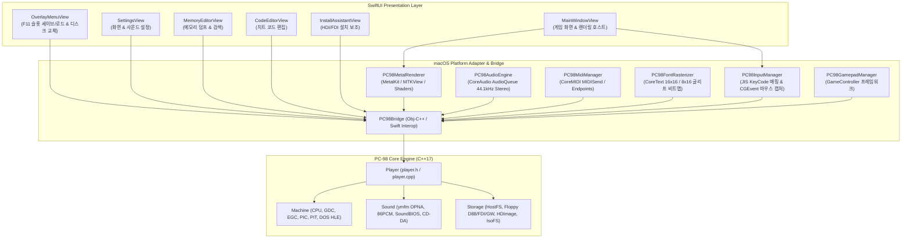

# PC98PLAYER macOS (SwiftUI) 네이티브 포팅 플랜

## 1. 개요 및 배경

본 문서는 Windows 전용(Win32 / DirectX / GDI)으로 개발된 PC-9801 에뮬레이션 플레이어 **PC98PLAYER**를 최신 macOS 환경의 네이티브 애플리케이션으로 포팅하기 위한 상세 개발 계획서입니다.

### 1.1 핵심 요구 조건
1. **SwiftUI 네이티브 개발**: macOS 디자인 가이드라인을 준수하는 SwiftUI 기반 UI 구성.
2. **Windows 버전과의 100% 동일한 기능 및 동작 사양**:
   - 화면 비율, 스무딩, 오디오 출력, MIDI 출력, 타이밍, 키/마우스 제어.
   - 단축키 및 F11 인게임 오버레이 메뉴 동일 제공.
3. **`README.md` 사용 설명서 완벽 준수**:
   - 게임 디렉토리 기반 실행 및 `PC98PLAYER.INI` 설정 관리.
   - HDI/FDI 이미지 및 폴더 드래그 앤 드롭을 통한 **설치 어시스턴트** 동작.
   - MS-DOS 우회 플로피 부트 모드(`Boot=FD`) 지원.
   - 메모리 에디터(640KB 헥스 덤프 & 필터링 검색) 및 코드 에디터(치트 코드 고정) 지원.
4. **C/C++ 코어의 무수정·최대 재사용**:
   - `core/` 디렉토리 내의 CPU, GDC/EGC, DOS HLE, FAT/ISO 파일시스템, 사운드 코어 등 C++ 소스는 Swift로 재작성하지 않고 그대로 컴파일하여 사용.

---

## 2. 시스템 아키텍처



---

## 3. 서브시스템별 상세 설계

### 3.1 비디오 렌더링 서브시스템 (Metal)
- **프레임버퍼 공급 구조**:
  - C++ `Player.fb` 버퍼(`uint32_t[640 * 400]`, 32비트 ARGB 포맷)를 매 프레임 Metal 텍스처(`MTLTexture`)로 전송 (`replaceRegion`).
- **셰이더 및 디스플레이 파이프라인**:
  - `MTKView` 기반 렌더링 파이프라인.
  - PC-98 표준 640x400 (16:10 종횡비) 유지 및 자동 레터박스/필러박스 처리.
  - 설정에 따른 텍스처 샘플링 방식 분기:
    - `Smooth=0`: `MTLSamplerMinMagFilterNearest` (선명한 픽셀 보존)
    - `Smooth=1`: `MTLSamplerMinMagFilterLinear` (부드러운 바이리니어 필터링)
  - `Scale`에 맞춘 기본 윈도우 크기 지정 및 Alt+Enter(또는 메뉴/버튼) 전체화면 전환 (`toggleFullScreen`).
- **타이밍 및 VSync**:
  - `CVDisplayLink`를 통해 디스플레이 주사율에 동기화.
  - PC-98 표준 프레임 주사율(약 56.4Hz)과 60Hz 간의 프레임 조절 로직 적용.
  - 고속 진행(Shift+F12 터보): 프레임 스킵 없이 루프 지연 제거 및 음성 렌더링 비활성화(`render_audio=false`)로 최대 배속 처리.

### 3.2 오디오 및 MIDI 서브시스템 (CoreAudio / CoreMIDI)
- **PCM 사운드 스트리밍**:
  - 코어에서 생성되는 `Player.audio` (44.1kHz, 16-bit, Interleaved Stereo PCM) 버퍼링.
  - `AudioQueue` (`AudioQueueNewOutput`) 또는 `AVAudioSourceNode`를 통해 저지연(Low-Latency) 버퍼 큐잉.
  - 버퍼 언더런/오버런 방지용 링버퍼(Ring Buffer) 구성.
  - 일시정지(`PauseInactive`) 또는 슬롯 로드 시 `audio_flush` 호출로 잔여 버퍼 즉시 플러시.
- **MIDI 통신**:
  - 코어의 `Player.midi_sink` 콜백에 Objective-C++ 함수 포인터 연결.
  - 코어에서 출력되는 MIDI 바이트 스트림(Short Msg 1~3바이트, SysEx 긴 메시지) 수신.
  - `CoreMIDI` API(`MIDIClientCreate`, `MIDIOutputPortCreate`, `MIDISend`)를 통해 외부 MIDI 기기 또는 macOS 내 가상 포트(IAC 드라이버)로 패킷 송신.
  - 앱 종료 또는 리셋 시 All Notes Off (0x7B) 및 All Sound Off (0x78) 일괄 송출.

### 3.3 가상 폰트 ROM (CoreText 래스터라이저)
- **폰트 생성 방식**:
  - Windows의 GDI `font_draw`를 macOS `CoreText` / `CoreGraphics` 기반으로 구현.
  - `FontSource` 콜백 구조체 채움:
    1. `kanji(void* user, uint16_t jis, uint8_t out[32])`:
       - JIS 구점 코드를 Shift_JIS 및 UTF-16으로 변환.
       - 16x16 흑백(1-bit) 비트맵 컨텍스트에 폰트 렌더링 후 32바이트(행당 2바이트)로 변환.
    2. `ank(void* user, uint8_t code, uint8_t out[16])`:
       - ASCII/반각 카타카나를 8x16 비트맵으로 렌더링 후 16바이트로 변환.
       - `FontShift=1` 적용 시 오른쪽이 빈 경우 1비트 우측 이동.
    3. `narrow(void* user, uint16_t jis, uint8_t out[16])`:
       - 전각 기호(年月日, ヰヱ 등)를 폭 8픽셀의 8x16 종장 형태로 축소 렌더링.
  - 기본 폰트로 macOS 내장 Hiragino Kaku Gothic / Hiragino Maru Gothic 사용, INI의 `Font=` 지정 폰트 로드 지원.

### 3.4 입력 서브시스템 (키보드, 마우스, 패드)
- **키보드 매핑 (`PC98KeyMapper`)**:
  - macOS `NSEvent.keyCode`를 PC-98 물리 스캔코드로 1:1 매핑:
    - 문자 및 숫자, 기호: JIS 물리 배열 기준.
    - 특수 기능키: `Option` ➔ GRPH, `Caps Lock/Kana` ➔ 카나, `PageUp/Down` ➔ ROLL DOWN/UP 등.
    - 단축키 우선 처리: `F11` (로드), `Shift+F11` (세이브), `Shift+F12` (터보), `Alt+Enter` (전체화면).
- **마우스 제어**:
  - 윈도우 클릭 시 마우스 잠금: `CGAssociateMouseAndMouseCursorPosition(false)`, `NSCursor.hide()`.
  - 상대 이동량(`deltaX`, `deltaY`)을 PC-98 버스 마우스 카운터에 가산.
  - 해제 조건: `F12` 키 입력 또는 마우스 휠 클릭(`MiddleRelease=1`).
  - `MouseLockDisable` 옵션(0: 클릭 시 잠금, 1: 잠금 안함, 2: 윈도우 호버 시 공유) 동작 완벽 재현.
- **게임패드 (`PC98GamepadManager`)**:
  - `GameController.framework`를 연동하여 연결된 컨트롤러 감지.
  - 방향키/아날로그 스틱 및 버튼 A/B, 연사(RAPID), 키 매핑 처리.

---

## 4. UI 및 윈도우 계층 설계 (SwiftUI)

### 4.1 메인 윈도우 및 F11 오버레이 (`MainWindowView`, `OverlayMenuView`)
- Metal 렌더링 뷰 위에 SwiftUI 오버레이 레이어 중첩.
- **F11 / Shift+F11 트리거**:
  - 에뮬레이션 루프 일시정지 및 8개 슬롯 썸네일(`STATE_THUMB_W 160 x STATE_THUMB_H 100`) 로드.
  - 슬롯 그리드 표시 (저장 일시, 비어있음 표시, 커서 하이라이트).
  - 하단 좌측: 플로피 드라이브(A:, B: / 드라이브 1, 2) 선택, 디스크 삽입/배출, 이전/다음 디스크(N/P).
  - 하단 우측: 프로그램 재기동(R), 화면&사운드 설정(S), 메모리 에디터(M), 코드 에디터(C) 바로가기.

### 4.2 화면 & 사운드 설정 창 (`SettingsView`)
- 별도 윈도우 또는 시트(Sheet)로 표시.
- 항목:
  - 표시 배율 (Scale 1x ~ 4x, 전체화면), 스무딩 (Nearest/Bilinear).
  - CPU 클록 (CpuMHz 4 ~ 66).
  - 사운드 보드 (86 / 26 / None), 사운드 BIOS 활성화, 사운드 IRQ.
  - MIDI 활성화, MIDI 출력 장치 선택, MIDI 속도 보정(10% ~ 1000%).
  - 볼륨 슬라이더 (마스터, FM, SSG, Beep, PCM, CD-DA).
  - 폰트 선택 및 FontShift, KanjiJIS(78/83) 선택.
- 저장 시 `PC98PLAYER.INI` 파일에 주석과 포맷을 유지하며 즉시 반영 (`ini_rewrite.h` 호환 로직).

### 4.3 메모리 에디터 창 (`MemoryEditorView`)
- 640KB 기본 메모리(0000:0000 ~ 9FFF:000F) 헥스 덤프 뷰어/에디터.
- 주소 검색, 16진수 바이트열 / 10진수(`s99`, `m999`, `l99999`) 직접 쓰기 (W 키 기능).
- 드래그 영역 지정 후 일괄 채우기.
- 필터링 검색:
  - Search RESET (게임 메모리 블록 범위 지정).
  - 값 검색 (Byte, Word, Dword) 및 변화 추적 (증가 `+`, 감소 `-`, 불동 `=`, 변동 `!=`).
- "조작 중 게임 일시정지" 체크박스 연동.

### 4.4 코드 에디터 창 (`CodeEditorView`)
- 주소와 값 쌍 치트 코드 편집 (예: `34784 3F420F00`, `34784%l9999`).
- 공백 구분 시 1회 쓰기, `%` 구분 시 매 프레임 쓰기.
- 메모리 에디터 검색 결과에서 더블 클릭 시 주소 자동 추가.
- `PC98PLAYER.SAV/CODES.TXT` 자동 로드 및 저장.

### 4.5 설치 어시스턴트 (`InstallAssistantView`)
- HDI / FDI / 폴더 드롭 시 자동 분기:
  1. **HDI 전개 모드**:
     - FAT12/FAT16 파티션 분석 후 카렌트 폴더로 파일 추출.
     - 시작 파일(.EXE, .BAT) 목록 제시 및 사용자 선택 ➔ `PC98PLAYER.INI` 생성 후 실행.
  2. **FDI 디스크 설치 모드**:
     - 복수 플로피 이미지 분석, 인스톨러(.EXE, .BAT) 선택.
     - 드라이브 설정 및 쓰기 금지 지정 후 설치 프로세스 시작.
     - F11 메뉴의 디스크 교체 기능과 연계.

---

## 5. C++ 코어 유지 및 Objective-C++ 브릿징 전략

### 5.1 C++ 코어 무수정 보존
`core/` 디렉토리 내의 소스는 macOS Clang C++17 환경에서 직접 컴파일되며 수정되지 않습니다:
- POSIX 호환 API가 이미 구현되어 있는 `core/hostfs.cpp`, `core/fdreal.cpp` 활용.
- `third_party/ymfm` 및 `third_party/dr_libs` 소스 빌드 결합.

### 5.2 `PC98Bridge` (Objective-C++ Wrapper)
Swift에서 C++ 엔진을 안전하고 객체지향적으로 제어할 수 있도록 `PC98Bridge` 클래스 정의:
```objc
@interface PC98Bridge : NSObject
- (BOOL)initializeWithIniPath:(NSString *)iniPath error:(NSError **)error;
- (void)runFrameRenderVideo:(BOOL)renderVideo renderAudio:(BOOL)renderAudio;
- (const uint32_t *)framebuffer;
- (const int16_t *)audioSamplesWithCount:(NSInteger *)sampleCount;
- (void)keyDown:(uint8_t)keyCode;
- (void)keyUp:(uint8_t)keyCode;
- (void)mouseMoveDx:(int)dx dy:(int)dy buttons:(int)buttons;
- (BOOL)saveStateToSlot:(int)slot error:(NSError **)error;
- (BOOL)loadStateFromSlot:(int)slot error:(NSError **)error;
- (PC98SlotInfo *)slotInfoForIndex:(int)slot;
- (BOOL)insertFloppyUnit:(int)unit path:(NSString *)path error:(NSError **)error;
- (void)ejectFloppyUnit:(int)unit;
- (void)reboot;
- (void)shutdown;
// 메모리/코드 에디터 지원 API
- (NSData *)dumpMemoryAtAddress:(uint32_t)address length:(uint32_t)length;
- (void)writeMemoryAtAddress:(uint32_t)address data:(NSData *)data;
@end
```

---

## 6. 프로젝트 디렉토리 구조

```
pc98player/
├── core/                        # C++ 에뮬레이션 코어 (무수정 유지)
├── third_party/                 # ymfm, dr_libs (무수정 유지)
├── tools/                       # 유틸리티 (fetch_ymfm.sh 추가)
├── mac/                         # macOS 포팅 구현 디렉토리
│   ├── PC98PlayerMac.xcodeproj  # Xcode 프로젝트
│   ├── Bridge/
│   │   ├── PC98Bridge.h         # Objective-C++ 브릿지 헤더
│   │   ├── PC98Bridge.mm        # 브릿지 구현 (Player 라이프사이클)
│   │   ├── PC98FontRasterizer.h # CoreText 폰트 래스터라이저 헤더
│   │   └── PC98FontRasterizer.mm# CoreText 폰트 래스터라이저 구현
│   ├── Video/
│   │   ├── PC98MetalView.swift  # MTKView 래퍼 및 프레임 렌더러
│   │   └── Shaders.metal        # 텍스처 렌더링 셰이더
│   ├── Audio/
│   │   ├── PC98AudioEngine.swift# CoreAudio AudioQueue 스트리밍
│   │   └── PC98MidiManager.swift# CoreMIDI 출력 관리자
│   ├── Input/
│   │   ├── PC98KeyMapper.swift  # macOS NSEvent -> PC-98 스캔코드
│   │   └── PC98Gamepad.swift    # GameController 연동
│   └── UI/                      # SwiftUI 인터페이스
│       ├── PC98App.swift        # App Entry Point
│       ├── MainWindowView.swift # 메인 게임 화면
│       ├── OverlayMenuView.swift# F11 오버레이 메뉴
│       ├── SettingsView.swift   # 화면 & 사운드 설정 창
│       ├── MemoryEditorView.swift # 메모리 에디터 창
│       ├── CodeEditorView.swift # 치트 코드 에디터 창
│       └── InstallAssistantView.swift # HDI/FDI 설치 어시스턴트
└── PORTING_PLAN_MACOS.md        # 본 개발 계획서
```

---

## 7. 단계별 개발 추진 일정 (Work Breakdown)

| 단계 | 작업 내용 | 주요 산출물 | 검증 방법 |
|---|---|---|---|
| **Phase 1** | **빌드 인프라 & C++ 코어 브릿지** | `tools/fetch_ymfm.sh`<br/>`PC98Bridge.h/mm`<br/>기본 Xcode 프로젝트 | macOS Clang에서 코어 컴파일 성공 및 헤드리스 프레임 실행 확인 |
| **Phase 2** | **비디오(Metal) & 폰트 래스터라이저** | `PC98MetalView.swift`<br/>`Shaders.metal`<br/>`PC98FontRasterizer.mm` | 640x400 그래픽 및 한자/ANK 폰트 정상 렌더링 확인 |
| **Phase 3** | **오디오, MIDI & 기본 입력** | `PC98AudioEngine.swift`<br/>`PC98MidiManager.swift`<br/>`PC98KeyMapper.swift` | OPNA 사운드/PCM/CD-DA 출력, MIDI 전송, 키보드/마우스 제어 동작 |
| **Phase 4** | **F11 오버레이 & 세이브/로드** | `OverlayMenuView.swift`<br/>슬롯 세이브/로드 로직 | F11/Shift+F11 오버레이, 썸네일 표시, 상태 복원 비트 일치 검증 |
| **Phase 5** | **보조 도구 & 설치 어시스턴트** | `SettingsView`<br/>`MemoryEditorView`<br/>`CodeEditorView`<br/>`InstallAssistantView` | INI 설정 수정 및 반영, 메모리 검색/치트 동작, HDI/FDI 전개 검증 |
| **Phase 6** | **통합 테스트 & 품질 점검** | 종합 동작 테스트 및 최종 코드 리뷰 | README.md 기재 모든 게임 시나리오 호환성 및 안정성 검증 |

---

## 8. 승인 및 피드백

본 개발안은 사용자님의 검토 및 승인 후 본격적인 코드 작성(Phase 1) 단계로 진입합니다. 추가 의견이나 세부 요구사항이 있으실 경우 언제든 조율 가능합니다.
